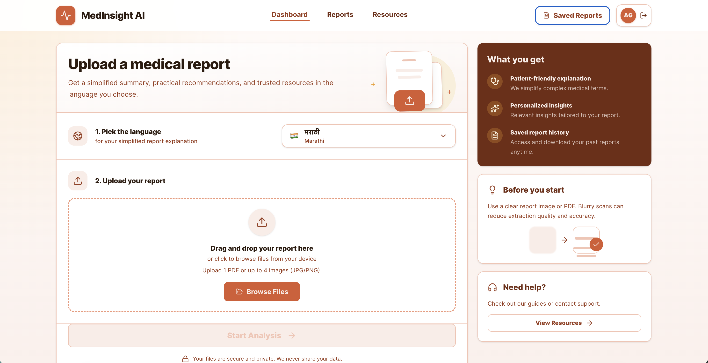
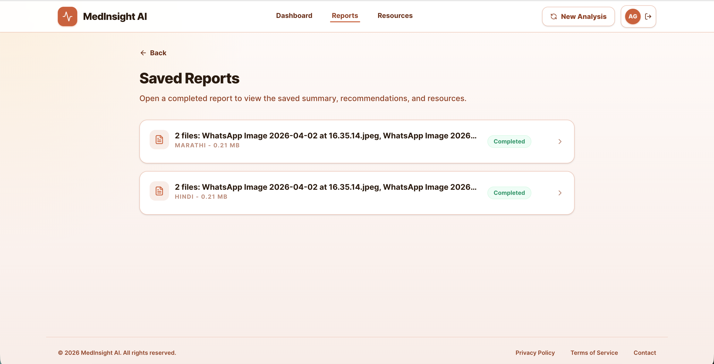
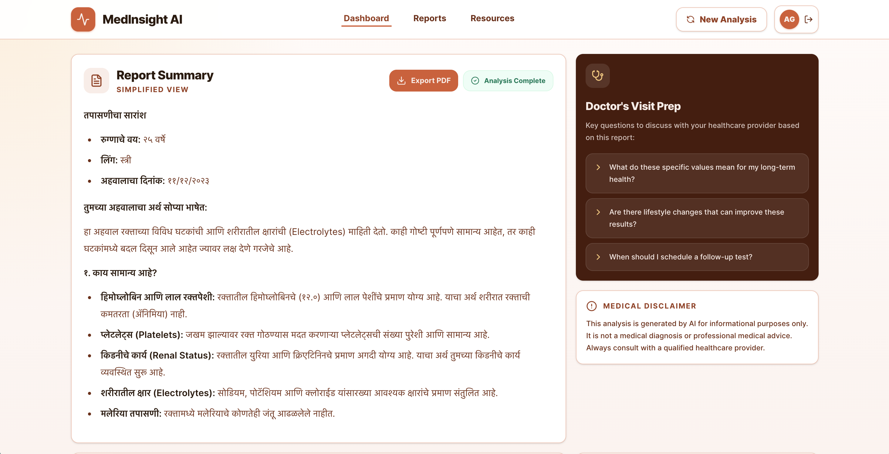
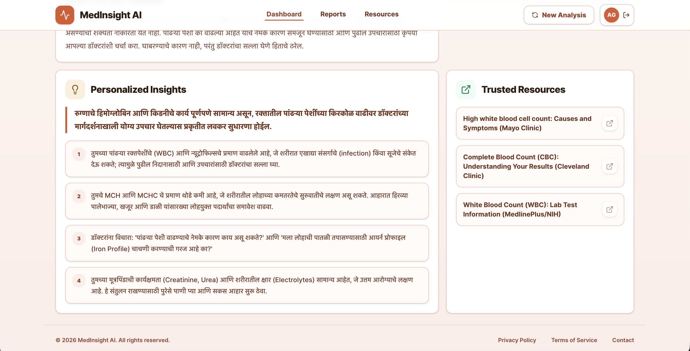

# 🩺 Medisync AI

**Medisync AI** is a full-stack web application that turns medical lab and imaging reports into plain-language summaries, practical follow-up suggestions, and links to reputable health information. Upload a PDF or image, choose an explanation language, and review the results in a local dashboard.

> **Medical disclaimer:** Medisync AI is an informational tool only. It does not provide medical diagnosis, advice, or treatment, and AI-generated explanations may be incomplete or inaccurate. Always consult a qualified healthcare provider for medical concerns.

## 🌟 Key Features

- **Modern dark UI:** A responsive, Gemini-inspired dark interface with glassmorphic cards, gradient accents, and motion effects.
- **Drag-and-drop upload:** Analyze one PDF or up to four JPG/PNG report images.
- **AI-assisted analysis:** Groq Vision extracts findings from uploaded images. PDF pages are rendered locally as images before they are sent for analysis.
- **Multilingual explanations:** Summaries and recommendations are available in English, Hindi, Marathi, Gujarati, Bengali, Tamil, Telugu, Kannada, Malayalam, Punjabi, Urdu, Odia, and Assamese.
- **Saved report library:** Reopen analyses, preview original uploads, and export a summary as PDF.
- **Local file-based persistence:** Report metadata is stored in a JSON file and uploaded documents are stored on disk. No account or cloud database is required.

> **Important:** Files are stored locally by the backend, but uploaded images and rendered PDF pages are transmitted to Groq for AI analysis. This application does not parse reports entirely offline.

## Screenshots

| Upload dashboard | Saved reports |
|---|---|
|  |  |

| Report summary | Insights and resources |
|---|---|
|  |  |

## 🛠️ Tech Stack

- **Frontend:** React, TypeScript, Vite, Tailwind CSS, Motion, React Router
- **Backend:** Node.js, TypeScript, Express
- **AI orchestration:** LangGraph
- **Vision model:** Groq `qwen/qwen3.8-27b`
- **Storage:** Local JSON metadata and uploaded files on disk
- **PDF support:** PDF.js and `@napi-rs/canvas` for rendering report pages; Playwright for PDF export

## 🚀 Getting Started

### Requirements

- Node.js **22.13+** or **24+** (required by the installed PDF.js version)
- npm
- A [Groq API key](https://console.groq.com/keys)

### 1. Clone the repository

```bash
git clone https://github.com/navneetsaini027/Medisync-AI.git
cd Medisync-AI
```

### 2. Configure and start the backend

From the project directory:

```powershell
cd server
npm install
Copy-Item .env.example .env
```

Open `server/.env` and set `GROQ_API_KEY` to your Groq API key. The default model is `qwen/qwen3.8-27b`; the backend listens at `http://localhost:3001`.

Start the API:

```powershell
npm start
```

The backend creates `server/reports.json` and `server/uploads/` when needed.

### 3. Configure and start the frontend

Open a second terminal in the project directory:

```powershell
cd frontend
npm install
Copy-Item .env.example .env
npm run dev
```

Open [http://localhost:3000](http://localhost:3000). Check the API at [http://localhost:3001/api/health](http://localhost:3001/api/health).

On macOS/Linux, use `cp .env.example .env` instead of `Copy-Item`.

If report-summary PDF export reports that a browser executable is missing, install the Playwright Chromium browser:

```bash
npx playwright install chromium
```

## Configuration

### Backend (`server/.env`)

| Variable | Default | Description |
|---|---|---|
| `HOST` | `localhost` | Backend bind address. Keep local unless you have secured the API. |
| `PORT` | `3001` | Backend port. |
| `CORS_ORIGIN` | `http://localhost:3000` | Comma-separated allowed frontend origins. |
| `GROQ_API_KEY` | — | Secret Groq API key. Required for analysis. |
| `GROQ_MODEL` | `qwen/qwen3.8-27b` | Groq vision model ID. |
| `GROQ_REQUEST_TIMEOUT_MS` | `600000` | Timeout per Groq request (10 minutes). |
| `ANALYSIS_TIMEOUT_MS` | `900000` | Overall analysis timeout (15 minutes). |
| `RATE_LIMIT_WINDOW_MS` | `900000` | Report API rate-limit window. |
| `RATE_LIMIT_MAX` | `120` | Maximum report API requests per window. |

Both AI timeout values have a 120-second minimum. The Express JSON body limit is 250 MB. If you put a reverse proxy in front of the backend, allow requests to remain open for at least 15 minutes.

### Frontend (`frontend/.env`)

| Variable | Default | Description |
|---|---|---|
| `VITE_API_BASE_URL` | `http://localhost:3001/api` | Backend API base URL used by the browser. |
| `VITE_API_PROXY_TARGET` | `http://localhost:3001` | Optional Vite development proxy target. |

Only put browser-safe configuration in frontend environment files. Never put API keys or other secrets in `VITE_*` variables.

## Data, privacy, and security

- Reports and original uploads are stored locally in `server/reports.json` and `server/uploads/`. Back up these paths to retain your data.
- Medical reports are sensitive health information. These local files are ignored by Git; do not commit, publish, or expose them.
- Uploaded images and locally rendered PDF pages are sent to Groq for inference. Review Groq’s terms and privacy practices before submitting real patient data, and only upload data you are authorized to process.
- The local API does not require authentication and is intended for trusted local use. Do not bind it to a public network or deploy it publicly without adding appropriate authentication, authorization, transport security, and data-protection controls.
- Groq model availability and usage limits are controlled by Groq. Temporary capacity and rate-limit errors may require waiting before retrying.

## Useful commands

Run these from their respective directories:

| Directory | Command | Purpose |
|---|---|---|
| `frontend/` | `npm run dev` | Start the Vite development server |
| `frontend/` | `npm run lint` | Run the TypeScript check |
| `frontend/` | `npm run build` | Create the production frontend build in `dist/` |
| `frontend/` | `npm run preview` | Preview the production build locally |
| `server/` | `npm start` | Start the API with `tsx watch` |

## API overview

The backend exposes these endpoints under `/api`:

| Method | Path | Purpose |
|---|---|---|
| `GET` | `/health` | Check API availability |
| `POST` | `/reports` | Save an uploaded report and metadata |
| `POST` | `/reports/:id/analyze` | Analyze a saved report with Groq |
| `GET` | `/reports` | List saved reports |
| `GET` | `/reports/:id` | Get a saved report |
| `GET` | `/reports/:id/files/:fileIndex` | Download an uploaded source file |
| `DELETE` | `/reports/:id` | Delete a report and its stored files |
| `POST` | `/reports/export-summary-pdf` | Generate a summary PDF |

## Project structure

```text
frontend/
  public/              Static assets and screenshots
  src/
    pages/             Upload, processing, history, and result screens
    lib/               API client and frontend utilities
server/
  src/
    controllers/       HTTP request handlers
    routes/            API route definitions
    services/          Local persistence, Groq analysis, and PDF export
    config/             Environment and server configuration
  reports.json         Created at runtime; local report metadata
  uploads/             Created at runtime; original uploaded files
```

## License

No license file is currently included. Unless a license is added, all rights remain with the project’s copyright holder.
